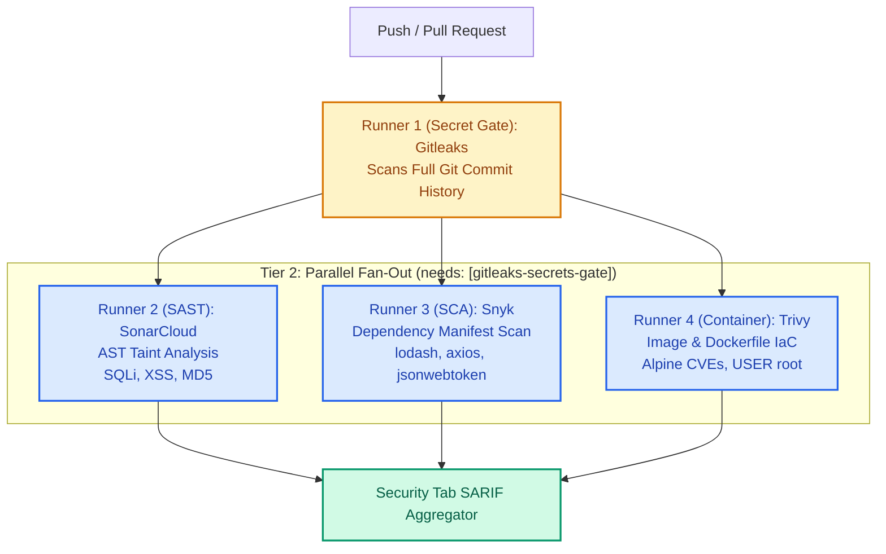

# DevSecOps Testing Laboratory & Benchmark

> **A containerized, intentionally vulnerable full-stack security testing laboratory** designed to benchmark and demonstrate how different DevSecOps scanners—**Gitleaks**, **SonarCloud / SonarQube**, **Snyk**, and **Trivy**—detect specific, isolated categories of security flaws across a CI/CD pipeline.

[](#pipeline-execution-architecture)
[](#1-secrets--credentials-target-gitleaks)
[](#2-application-code-flaws--sast-target-sonarqube--sonarcloud)
[](#3-outdated--compromised-dependencies--sca-target-snyk)
[](#4-container-image--os-misconfigurations-target-trivy)

---

## Table of Contents
1. [Overview & Benchmarking Objectives](#overview--benchmarking-objectives)
2. [Security Suite & Tooling Roles](#security-suite--tooling-roles)
3. [Vulnerability Mapping & Comprehensive Benchmark Matrix](#vulnerability-mapping--comprehensive-benchmark-matrix)
4. [Deep-Dive: Why Each Scanner Detected or Ignored Flaws](#deep-dive-why-each-scanner-detected-or-ignored-flaws)
5. [CI/CD Pipeline Architecture (2-Tier Parallel Fan-Out)](#cicd-pipeline-architecture-2-tier-parallel-fan-out)
6. [Interactive Application & Exploit Verification](#interactive-application--exploit-verification)
7. [Local Spin-Up Guide (Docker Compose & CLI)](#local-spin-up-guide-docker-compose--cli)
8. [Remediation & Hardening Blueprint](#remediation--hardening-blueprint)

---

## Overview & Benchmarking Objectives

Modern DevSecOps relies on specialized automated tooling operating at different layers of the software development lifecycle (SDLC). However, developers and security engineers often experience confusion regarding tool overlap, false sense of security, and scanner boundaries.

This project provides an intentionally vulnerable, reproducible testbed where each security flaw is isolated to demonstrate:
- **Gitleaks**: Secrets and credential scanning in commit history and configuration templates.
- **SonarCloud / SonarQube**: Static Application Security Testing (SAST) via Abstract Syntax Tree (AST) taint analysis for custom source code flaws.
- **Snyk**: Software Composition Analysis (SCA) inspecting open-source dependencies and package manifests against known CVE databases.
- **Trivy**: Container image and Infrastructure-as-Code (IaC) scanning targeting base OS package vulnerabilities and Dockerfile misconfigurations.

---

## Security Suite & Tooling Roles

```
                                  [ Git Push / Pull Request ]
                                               │
                                               ▼
                              ┌──────────────────────────────────┐
                              │     RUNNER 1: SECRET GATE        │
                              │   Gitleaks (Full Git History)    │
                              │   AWS Keys, RSA Certs, .env URI  │
                              └─────────────────┬────────────────┘
                                                │ (Gate Passes / Evaluated)
                    ┌───────────────────────────┼───────────────────────────┐
                    ▼                           ▼                           ▼
        ┌───────────────────────┐   ┌───────────────────────┐   ┌───────────────────────┐
        │   RUNNER 2 (SAST)     │   │    RUNNER 3 (SCA)     │   │ RUNNER 4 (CONTAINER)  │
        │      SonarCloud       │   │         Snyk          │   │        Trivy          │
        ├───────────────────────┤   ├───────────────────────┤   ├───────────────────────┤
        │ • SQL Injection       │   │ • Prototype Pollution │   │ • Alpine OS CVEs      │
        │ • Reflected XSS       │   │   (lodash@4.17.15)    │   │ • USER root execution │
        │ • Insecure MD5/SHA1   │   │ • JWT Alg Confusion   │   │ • Unneeded debugging  │
        │   Password Hashing    │   │ • SSRF (axios@0.21.1) │   │   tools (netcat/curl) │
        └───────────────────────┘   └───────────────────────┘   └───────────────────────┘
```

---

## Vulnerability Mapping & Comprehensive Benchmark Matrix

The following benchmark matrix compares all 6 intentionally introduced flaws against the four scanners:

| # | Vulnerability & CWE | Location | Detecting Scanner | Why Other Scanners Ignored It | Recommended Remediation |
|---|---|---|---|---|---|
| **1** | **Hardcoded AWS Credentials & RSA Private Key**<br>`CWE-798: Hard-coded Credentials` | [`.env.example`](file:///.env.example)<br>[`src/config/jwtRS256.key`](file:///src/config/jwtRS256.key)<br>[`src/config/secrets.js`](file:///src/config/secrets.js) | **Gitleaks**<br>*(Secret Hunter)* | **SonarCloud**: Ignores static string constants without taint sinks.<br>**Snyk SCA**: Only parses dependency version trees in `package.json`.<br>**Trivy**: Container image scanner looks at installed packages/binaries, not commit history. | Revoke exposed keys immediately; inject dynamic secrets at container runtime using AWS Secrets Manager, HashiCorp Vault, or encrypted CI secrets. |
| **2** | **SQL Injection (Raw String Concatenation)**<br>`CWE-89: SQL Injection`<br>`OWASP A03:2021` | [`src/routes/users.js`](file:///src/routes/users.js#L26-L45) | **SonarCloud**<br>*(SAST AST Taint)* | **Gitleaks**: SQL queries do not match token entropy or regex credentials.<br>**Snyk SCA**: SQLite driver itself is not CVE-vulnerable; flaw is custom query logic.<br>**Trivy**: Trivy does not analyze JavaScript AST dataflow. | Replace string concatenation with parameterized prepared statements (`db.all("SELECT ... WHERE username = ?", [userQuery])`). |
| **3** | **Reflected Cross-Site Scripting (XSS)**<br>`CWE-79: Improper Neutralization of Input` | [`src/routes/profile.js`](file:///src/routes/profile.js#L28-L58) | **SonarCloud**<br>*(SAST AST Taint)* | **Gitleaks**: HTML string reflection carries zero credential signatures.<br>**Snyk SCA**: Express framework itself is not vulnerable; custom template lacks escaping.<br>**Trivy**: Cannot inspect HTTP response payloads or server routing code. | Sanitize and context-encode untrusted input before rendering into HTML; implement strict `Content-Security-Policy` (CSP) response headers. |
| **4** | **Insecure Cryptographic Hashing (MD5/SHA-1)**<br>`CWE-327: Broken Crypto Algorithm`<br>`CWE-916: Insufficient Computational Effort` | [`src/routes/auth.js`](file:///src/routes/auth.js#L27-L62) | **SonarCloud**<br>*(SAST Rules S2070/S4790)* | **Gitleaks**: Algorithm invocations do not constitute leaked secrets.<br>**Snyk SCA**: `crypto` is a Node.js standard built-in module, not a third-party package.<br>**Trivy**: Scans OS packages, not crypto calls in JavaScript syntax. | Deprecate MD5 and SHA-1; employ salted password-hashing algorithms designed for resistance against GPU/ASIC brute force (Argon2id or PBKDF2 with $\ge 100{,}000$ iterations). |
| **5** | **Prototype Pollution & Known Library CVEs**<br>`CWE-1321: Prototype Pollution`<br>`CVE-2019-10744` / `CVE-2022-23529` | [`package.json`](file:///package.json#L24-L27)<br>[`src/routes/data.js`](file:///src/routes/data.js#L30-L55) | **Snyk**<br>*(SCA Dependency Analysis)* | **Gitleaks**: Package names and version strings are public metadata.<br>**SonarCloud**: Static AST taint analysis focuses on internal code flow, not cross-referencing external CVE advisories.<br>**Trivy (Image mode)**: If configured solely for OS packages, container scanning bypasses application-level npm dependencies. | Run `npm audit fix` or upgrade dependencies to secure releases: `lodash >= 4.17.21`, `jsonwebtoken >= 9.0.0`, and `axios >= 1.6.0`. |
| **6** | **Outdated Base OS Image & Root Execution**<br>`CWE-250: Execution with Unnecessary Privileges`<br>`Trivy DS002 / Alpine CVEs` | [`Dockerfile`](file:///Dockerfile#L18-L32) | **Trivy**<br>*(Container & IaC Scanner)* | **Gitleaks**: Docker instructions contain no credentials.<br>**SonarCloud**: SAST does not analyze Dockerfile instructions or Linux package databases.<br>**Snyk SCA (Standard)**: Standard language SCA targets `package.json`, not Alpine OS package registries (musl/busybox). | Update base image to modern supported release (`FROM node:20-alpine`); switch to non-root user (`USER node`); remove unneeded debug utilities (`curl`, `netcat`, `busybox-extras`). |
| **7** | **OS Command Injection**<br>`CWE-78: Command Injection`<br>`OWASP A03:2021` | [`src/routes/tools.js`](file:///src/routes/tools.js#L20-L40) | **SonarCloud / SAST**<br>*(AST Taint Rule S2076)* | **Gitleaks**: Shell commands are not secrets.<br>**Snyk SCA**: Native `child_process` module is built into Node.js runtime.<br>**Trivy**: Trivy cannot inspect runtime shell execution strings. | Avoid invoking system shells (`child_process.exec`); use safe argument arrays with `child_process.execFile` or validate inputs against strict allowlists. |
| **8** | **Path Traversal (Arbitrary File Read)**<br>`CWE-22: Improper Limitation of Pathname` | [`src/routes/tools.js`](file:///src/routes/tools.js#L42-L65) | **SonarCloud / SAST**<br>*(AST Taint Rule S2083)* | **Gitleaks**: File paths do not match high-entropy secret patterns.<br>**Snyk SCA**: `fs` is standard library.<br>**Trivy**: File read logic is evaluated inside application runtime. | Sanitize path inputs, verify canonical resolved paths against a secure base root directory (`path.resolve()`). |

---

## Deep-Dive: Why Each Scanner Detected or Ignored Flaws

### 1. Gitleaks (Secret Hunter)
- **Detection Mechanism**: Searches files, commit patches, and complete git revision logs using high-entropy calculation (Shannon entropy) combined with regex matching against known vendor token syntax (e.g., AWS `AKIA...`, private RSA headers, connection URIs).
- **Why it caught the secrets**: `.env.example`, `src/config/jwtRS256.key`, and `src/config/secrets.js` contain recognizable credential structures with high randomness.
- **Why it bypassed SAST, SCA, and Container flaws**: Gitleaks has no semantic model of programming languages. It cannot parse SQL queries, understand HTML DOM injection, or resolve dependency trees.

### 2. SonarCloud / SonarQube (Static Application Security Testing)
- **Detection Mechanism**: Parses source code into an Abstract Syntax Tree (AST) and performs data-flow taint analysis. It defines sources (untrusted user inputs like `req.query`, `req.body`), sanitizers (encoding or validation functions), and sinks (dangerous execution targets like `db.all()`, `res.send()`, or `crypto.createHash()`).
- **Why it caught SQLi, XSS, and MD5**:
  - `src/routes/users.js`: Untrusted input `req.query.query` connects directly to the `db.all()` sink without passing through an escaping sanitizer (Rule `javascript:S3649`).
  - `src/routes/profile.js`: Tainted `name` variable is injected into an unescaped HTML template string sent to `res.send()` (Rule `javascript:S5131`).
  - `src/routes/auth.js`: Detects banned cryptographic algorithm `crypto.createHash('md5')` flagged by static rule `javascript:S2070`.
- **Why it bypassed SCA and OS CVEs**: SAST tools inspect authored application code. They do not cross-reference third-party package version numbers against National Vulnerability Database (NVD) entries, nor do they inspect the underlying Linux container filesystem.

### 3. Snyk (Software Composition Analysis)
- **Detection Mechanism**: Inspects manifest files (`package.json`, `package-lock.json`) to construct an exact dependency tree. It hashes package identifiers and queries the proprietary Snyk Vulnerability Database and NVD for known published CVEs.
- **Why it caught Lodash, JWT, and Axios flaws**:
  - `lodash@4.17.15` matches CVE-2019-10744, CVE-2020-8203, and CVE-2021-23337 (Prototype Pollution).
  - `jsonwebtoken@8.5.1` matches CVE-2022-23529 and CVE-2022-23540 (Algorithm confusion & insecure key parsing).
  - `axios@0.21.1` matches CVE-2020-28168 (SSRF via unvalidated path redirection).
- **Why it bypassed SQLi, XSS, and AWS Keys**: Standard SCA is blind to custom business logic and code dataflow. Unless Snyk Code (their separate SAST product) is invoked, Snyk SCA solely evaluates external third-party manifests.

### 4. Trivy (Container & IaC Security)
- **Detection Mechanism**: Scans container layers, extracting Linux distribution package managers (`apk`, `dpkg`, `rpm`) and querying OS security advisories (Alpine SecDB, Debian Security Tracker). Simultaneously, its IaC misconfiguration engine parses Dockerfile ASTs for security anti-patterns against CIS Docker Benchmarks.
- **Why it caught Alpine CVEs and Root Execution**:
  - `node:14.21.3-alpine3.17`: Contains dozens of unpatched Alpine 3.17 CVEs across `busybox`, `musl`, `openssl`, and `zlib`.
  - `USER root`: Violates CIS Benchmark Rule DS002 ("Specify at least one non-root user").
  - Extraneous binaries: Flags `curl`, `netcat`, and `telnet` as expanding the image attack surface.
- **Why it bypassed SQLi and XSS**: Trivy inspects the packaged container filesystem at rest, having no execution context or taint engine to evaluate application-level request routing.

---

## CI/CD Pipeline Architecture (2-Tier Parallel Fan-Out)

The GitHub Actions workflow defined in [`.github/workflows/devsecops-pipeline.yml`](file:///.github/workflows/devsecops-pipeline.yml) enforces a strict **2-Tier execution topology**:



### Pipeline Gating Characteristics:
1. **Tier 1 (Blocking Gate)**: `Runner 1` executes first. In an enterprise setting, any detected secret fails the pipeline immediately to prevent credential compromise.
2. **Tier 2 (Parallel Fan-Out)**: As soon as Runner 1 completes, Runners 2, 3, and 4 launch concurrently via GitHub Actions `needs: [gitleaks-secrets-gate]`, reducing total pipeline execution time by up to 60%.
3. **Unified SARIF Reporting**: All four runners export standardized SARIF (`.sarif`) or JSON logs uploaded directly to the GitHub Security / Code Scanning tab.

---

## Interactive Application & Exploit Verification

When spun up locally, the lab serves an interactive web dashboard at `http://localhost:3000` allowing hands-on execution of each vulnerability:

```
┌─────────────────────────────────────────────────────────────────────────────┐
│                       DevSecOps Testing Laboratory                          │
│   Benchmarking Gitleaks, SonarCloud, Snyk, and Trivy across Flaw Domains    │
├─────────────────────────────────────────────────────────────────────────────┤
│  [1. Secrets Hunter]     [2. SQL Injection]      [3. Reflected XSS]         │
│  Target: Gitleaks        Target: SonarCloud      Target: SonarCloud         │
│  AWS Key: AKIAIOSF...    Payload: ' OR '1'='1    Payload: <script>alert...  │
│  [ Inspect Secrets ]     [ Exploit SQLi ]        [ Trigger XSS ]            │
├─────────────────────────────────────────────────────────────────────────────┤
│  [4. Broken Crypto]      [5. SCA Dependencies]   [6. Container/Trivy]       │
│  Target: SonarCloud      Target: Snyk SCA        Target: Trivy Container    │
│  Hash: MD5 (Unsalted)    Lodash Prototype Poll.  node:14-alpine + USER root │
│  [ Hash with MD5 ]       [ Trigger Pollution ]   [ View Container Spec ]    │
└─────────────────────────────────────────────────────────────────────────────┘
```

### Manual Verification Curl Commands:

#### 1. Exploit SQL Injection (SonarCloud Target)
```bash
# Bypass authentication and dump all registered users via SQL concatenation
curl -s "http://localhost:3000/api/users/search?query='%20OR%20'1'='1" | jq .
```

#### 2. Trigger Reflected XSS (SonarCloud Target)
```bash
# Verify raw HTML response containing unescaped script tag
curl -s "http://localhost:3000/profile/greeting?name=%3Cscript%3Ealert('Pwned')%3C%2Fscript%3E"
```

#### 3. Test Insecure MD5 Password Hashing (SonarCloud Target)
```bash
# Register user and inspect the unsalted 32-character MD5 hash
curl -s -X POST http://localhost:3000/api/auth/register-insecure \
  -H "Content-Type: application/json" \
  -d '{"username": "victim", "password": "SuperSecretPassword123"}' | jq .
```

#### 4. Trigger Prototype Pollution via Lodash (Snyk SCA Target)
```bash
# Pollute Object.prototype using vulnerable lodash@4.17.15 merge
curl -s -X POST http://localhost:3000/api/data/merge \
  -H "Content-Type: application/json" \
  -d '{"__proto__": {"polluted": "CRITICAL: Object.prototype has been contaminated"}}' | jq .
```

---

## Local Spin-Up Guide (Docker Compose & CLI)

### Option A: Spin Up Full Stack via Docker Compose
To launch the complete laboratory with the vulnerable app and PostgreSQL backend:
```bash
# Build and run all services in the background
docker-compose up --build -d

# Check running status
docker-compose ps

# Access interactive dashboard
open http://localhost:3000
```

### Option B: Run the Security Suite Locally with Docker
You can execute all four scanners on your local workstation without configuring GitHub Actions:
```bash
# Run all scanners using the automated benchmark script
./scripts/run-all-scanners.sh
```

Or invoke each scanner individually via Docker:

#### 1. Run Gitleaks Locally
```bash
docker run --rm -v "$PWD":/path zricethezav/gitleaks:latest detect \
  --source=/path \
  --config=/path/.gitleaks.toml \
  --verbose
```

#### 2. Run Trivy Container & IaC Scan Locally
```bash
# Build target image
docker build -t secops-vulnerable-app:local .

# Scan image for OS CVEs
docker run --rm -v /var/run/docker.sock:/var/run/docker.sock aquasec/trivy:latest \
  image --severity HIGH,CRITICAL secops-vulnerable-app:local

# Scan Dockerfile for IaC misconfigurations
docker run --rm -v "$PWD":/work -w /work aquasec/trivy:latest \
  config .
```

#### 3. Run Snyk SCA Locally
```bash
# Test dependencies via Snyk CLI (requires free Snyk account)
snyk test

# Or inspect native npm security baseline
npm audit
```

---

## Remediation & Hardening Blueprint

For educational benchmark completion, each vulnerable endpoint in `src/routes/` is paired with a production-grade hardened equivalent:

```
┌─────────────────────────────────┬───────────────────────────────────────────┐
│ Vulnerable Pattern              │ Hardened Remediation                      │
├─────────────────────────────────┼───────────────────────────────────────────┤
│ "SELECT * WHERE name = '" + q   │ db.all("SELECT * WHERE name = ?", [q])    │
│ res.send(`<h1>${q}</h1>`)       │ res.send(`<h1>${escapeHtml(q)}</h1>`)     │
│ crypto.createHash('md5')        │ crypto.pbkdf2Sync(pwd, salt, 100000, ...) │
│ lodash@4.17.15                  │ npm install lodash@^4.17.21               │
│ FROM node:14.21.3-alpine3.17    │ FROM node:20-alpine                       │
│ USER root                       │ USER node                                 │
└─────────────────────────────────┴───────────────────────────────────────────┘
```
